# Markdown Studio - 独立阅读与编辑器项目交接文档 (HANDOVER.md)

---

## 1. 项目背景与设计演进

### 1.1 背景与原始需求
本项目最初旨在为本地知识管理与文档阅读提供一个现代化、高保真、沉浸式的 Markdown 阅读与编辑环境。在项目启动初期，曾参考了本地已完成的 Chrome 扩展项目（`03-MarkdownReader-Chrome扩展-已完成/1.0.1_0`）。经过深度调研与需求研判，明确了以下关键演进决策：

1. **彻底摆脱浏览器扩展的架构局限**：
   - Chrome 扩展受限于浏览器严格的安全沙箱机制，无法对本地磁盘任意目录建立工作区文件树（Workspace/Vault），无法自由读写、重命名和删除本地文件。
   - 扩展无法直接关联系统 `.md` 文件的双击打开方式，缺乏独立菜单栏、系统级快捷键与脱离浏览器标签页运行的能力。
2. **坚决剥离扩展代码包袱**：
   - 不复用任何经过逆向或打包压缩的 Chrome 插件 bundle 代码，不引入复杂的 Background ServiceWorker / ContentScript 通信机制。
   - 采用纯净、现代、清晰分层的标准软件工程架构进行从零构建。
3. **以 GitHub 成熟开源组件为核心底座**：
   - 经对 GitHub 上数十个开源 Markdown 项目（Tencent Cherry Markdown、b3log/vditor、Milkdown、ByteMD、Muya、CodeMirror 6 等）的深度对比，选定 **Vditor (v3.10.8)** 为前端排版与编辑核心引擎。
   - **选型理由**：Vditor 原生同时支持“高保真纯静态阅读模式 (`Vditor.preview`)”、“即时渲染模式 (IR / Typora 式)”、“双栏分屏模式 (SV)”与“所见即所得 (WYSIWYG)”，内置完备的 KaTeX 数学公式、Mermaid 图表、代码高亮及目录提取能力，能以极高成熟度覆盖 95% 以上的前端排版技术风险。
4. **统一 Python 技术栈与轻量原生桌面宿主**：
   - 项目归属于 `5-Python/进行中/20-MarkdownReader-独立阅读编辑器-开发中`，采用 **Python 3.12 + PyWebView** 构建原生 macOS Cocoa/WebKit 窗口。
   - **运行优势**：内存占用仅 50~80MB（远低于 Electron 的数百兆），启动速度快，且通过 PyWebView 内置本地 HTTP 服务（Bottle）实现 100% 离线脱网运行。
5. **坚持“严格模块化、零交叉引用”工程契约**：
   - 后端各 service 模块之间禁止相互 import，统一由 `DesktopBridge` 门面（Facade）聚合。
   - 前端各业务模块之间禁止相互引用或直接调用，全部基于 `window.AppBus`（事件发布订阅）与 `window.AppStore`（单向状态流）进行解耦协同。

---

## 2. 完整目录结构与文件职责字典

项目整体代码规模为 **7,573 行**（涵盖 Python 后端、前端核心层、8 个业务模块、4 套 CSS 样式体系与全链路测试）。

```text
20-MarkdownReader-独立阅读编辑器-开发中/
├── backend/                             # Python 模块化后端服务 (零交叉引用)
│   ├── __init__.py                      # 后端包声明 (4 行)
│   ├── config_service.py                # 用户偏好设置持久化服务 (96 行)
│   ├── file_service.py                  # 本地文件与工作区目录树 IO 服务 (294 行)
│   ├── asset_service.py                 # 剪贴板图片保存与独立 HTML 导出服务 (257 行)
│   └── bridge.py                        # PyWebView 统一 API 门面 Facade (187 行)
├── frontend/                            # 前端 Web 应用层
│   ├── index.html                       # 桌面应用单页结构骨架 (298 行)
│   ├── vendor/                          # 100% 离线第三方开源依赖
│   │   └── vditor/dist/                 # Vditor 3.10.8 完整生产包 (含 Lute, KaTeX, Mermaid, Highlight)
│   ├── js/
│   │   ├── app.js                       # 前端启动编排与生命周期总入口 (87 行)
│   │   ├── core/                        # 核心底座抽象层
│   │   │   ├── event-bus.js             # 全局解耦事件总线 window.AppBus (115 行)
│   │   │   ├── store.js                 # 响应式全局状态树 window.AppStore (251 行)
│   │   │   └── bridge-client.js         # Python 后端桥接客户端 window.BridgeClient (452 行)
│   │   └── modules/                     # 8 个独立业务模块 (通过 AppBus 协同)
│   │       ├── editor-engine.js         # 四模式编辑/阅读引擎封装与渲染派发 (646 行)
│   │       ├── tab-manager.js           # 多标签页、文件打开、自动保存与自动刷新 (539 行)
│   │       ├── file-tree.js             # 左侧工作区文件树、排序、过滤与文件增删改 (597 行)
│   │       ├── toc-outline.js           # 目录大纲树提取、搜索过滤与 ScrollSpy 视口追踪 (477 行)
│   │       ├── md-enhancer.js           # Callout 提示块、图片尺寸、复选框点击增强 (265 行)
│   │       ├── appearance.js            # 外观设置抽屉、主题/字体/排版与动态 CSS (365 行)
│   │       ├── lightbox.js              # 全屏高保真图片灯箱、缩放、拖拽与缩略图 (357 行)
│   │       └── exporter-status.js       # 底部状态栏指标、独立导出、打印与全局快捷键 (473 行)
│   └── styles/                          # 模块化 CSS 样式体系
│       ├── base.css                     # 全局样式重置、基础变量与骨架布局 (258 行)
│       ├── themes.css                   # 浅色、深色、跟随系统的多主题调色板 (227 行)
│       ├── components.css               # 标签栏、工具栏、文件树、大纲、设置抽屉与灯箱样式 (635 行)
│       └── markdown-ext.css             # Markdown 排版增强、Callout 容器与打印样式 (296 行)
├── sample/                              # 示例工作区
│   ├── welcome.md                       # 全功能演示文档 (178 行)
│   └── assets/                          # 演示文档配套本地资源
│       └── welcome_cover.svg            # 矢量封面图
├── main.py                              # 桌面应用主程序入口 (216 行)
├── test_e2e.py                          # 真实 WebKit 原生窗口自动化 E2E 验证脚本 (282 行)
├── run.command                          # macOS 双击一键启动脚本 (16 行)
├── requirements.txt                     # 生产环境依赖清单 (3 行)
├── README.md                            # 项目快速上手指南
├── PROJECT_SUMMARY.md                   # 项目工程总结
└── HANDOVER.md                          # 本交接文档
```

---

## 3. 模块化通信架构与接口契约（核心交接指南）

### 3.1 总体架构交互流

```mermaid
flowchart TD
    subgraph Host ["Python 原生宿主 (main.py)"]
        PV[PyWebView 原生 Cocoa/WebKit 窗口]
        Bridge[DesktopBridge 聚合门面]
        CS[config_service.py]
        FS[file_service.py]
        AS[asset_service.py]
        Bridge --> CS
        Bridge --> FS
        Bridge --> AS
    end

    subgraph Core ["前端基础设施 (frontend/js/core)"]
        BC[BridgeClient]
        Bus[AppBus 发布订阅]
        Store[AppStore 集中状态]
    end

    subgraph Modules ["前端业务模块 (frontend/js/modules)"]
        M1[EditorEngine]
        M2[TabManager]
        M3[FileTree]
        M4[TocOutline]
        M5[MdEnhancer]
        M6[Appearance]
        M7[Lightbox]
        M8[ExporterStatus]
    end

    PV <==>|js_api HTTP 桥接| BC
    BC <--> Modules
    Modules <==>|事件通信| Bus
    Modules <==>|状态读写| Store
```



---

### 3.2 后端 Facade 契约（`DesktopBridge` API 清单）

所有接口统一挂载在 Python `DesktopBridge` 类上，由 `main.py` 作为 `js_api` 注入 PyWebView。
所有方法返回值均严格符合统一结构：`{"ok": True, "data": ...}` 或 `{"ok": False, "error": "..."}`。

| 接口名称 | 参数签名 | 返回数据格式 (`data`) | 详细说明 |
| :--- | :--- | :--- | :--- |
| `get_initial_state` | `()` | `{"preferences", "welcome_path", "target_file", "workspace_dir", "project_root"}` | 应用启动时获取初始状态、偏好设置与默认打开文档 |
| `read_file` | `(path: str)` | `{"path", "name", "content", "mtime", "size"}` | 读取本地文件，支持 UTF-8 / UTF-8-sig / GBK / GB18030 多重容错 |
| `write_file` | `(path: str, content: str)` | `{"path", "mtime", "size"}` | **原子安全写入**（基于同目录临时文件 + `os.replace`），杜绝损坏 |
| `list_dir` | `(dir_path: str, show_hidden=False, sort_by="name", sort_asc=True)` | `{"root", "tree": [{"name", "path", "is_dir", "size", "mtime", "children"}]}` | 递归扫描工作区（限深 4 层，目录优先排序，过滤 `.git` 等重量目录） |
| `create_item` | `(parent_dir: str, name: str, is_dir=False)` | `{"path": str}` | 新建文件（无后缀自动追加 `.md`）或目录 |
| `rename_item` | `(old_path: str, new_name: str)` | `{"path": str}` | 重命名文件或目录，自带同名冲突拦截 |
| `delete_item` | `(path: str)` | `{"path": str}` | 从磁盘删除文件或空目录 |
| `check_files_mtime` | `(paths: list)` | `{path: float_mtime_or_null}` | 批量检查修改时间，供前端实现 2000ms 外部文件修改无感自动刷新 |
| `save_clipboard_image` | `(current_md_path: str, filename: str, base64_data: str)` | `{"rel_path", "abs_path", "file_url"}` | 剪贴板图片 Base64 解码，落盘至 `./assets/`，返回相对路径语法 |
| `export_standalone_html`| `(target_path: str, title: str, body_html: str, theme_css="", custom_css="")` | `{"path": str}` | 导出完全自包含样式与 KaTeX 的独立单文件 HTML |
| `load_preferences` | `()` | 用户偏好字典 | 读取 `~/.markdown_studio_prefs.json` |
| `save_preferences` | `(prefs: dict)` | 保存后的偏好字典 | 原子持久化偏好设置到用户目录 |
| `select_file_dialog` | `()` | `{"path": str}` | 调起 macOS 原生文件选择对话框（支持取消检测） |
| `select_folder_dialog`| `()` | `{"path": str}` | 调起 macOS 原生工作区文件夹选择对话框 |
| `export_html_dialog` | `(default_name: str, html_content: str)` | `{"path": str}` | 调起 macOS 原生保存文件对话框并触发自包含 HTML 写入 |

---

### 3.3 前端 EventBus 事件契约（`window.AppBus`）

前端所有模块彻底解耦，模块间绝无直接方法调用，完全通过 `window.AppBus.emit(event, payload)` 与 `window.AppBus.on(event, handler)` 进行协同。

| 事件名称 | 触发源 (Emitter) | 主要监听方 (Listener) | 负载结构 (Payload) | 事件职责与业务联动 |
| :--- | :--- | :--- | :--- | :--- |
| `file:open-request` | `app.js` / `file-tree.js` | `tab-manager.js` | `{ path: string }` | 请求打开指定磁盘路径的文件 |
| `folder:open-request`| `app.js` / `file-tree.js` | `file-tree.js` | `{ path: string }` | 请求载入指定工作区根目录并重新扫描文件树 |
| `file:save-request` | `exporter-status.js` / `md-enhancer.js` | `tab-manager.js` | `{ tab?: object }` | 请求立即执行当前活动标签页的磁盘保存 |
| `file:saved` | `tab-manager.js` | `file-tree.js` | `{ path: string, mtime: number }` | 磁盘文件保存成功，通知文件树刷新对应节点状态 |
| `tab:added` | `store.js` | `tab-manager.js` | `{ tab: object }` | 新标签页加入状态树，渲染标签栏项 |
| `tab:activated` | `store.js` | `tab-manager.js` / `editor-engine.js` / `toc-outline.js` / `exporter-status.js` | `{ tab: object }` | 活动标签页发生切换，编辑器载入内容并刷新大纲与状态栏 |
| `tab:switched` | `tab-manager.js` | `editor-engine.js` / `toc-outline.js` / `exporter-status.js` | `{ tab: object }` | 标签页显式切换事件（与 `tab:activated` 双保险对齐） |
| `tab:closed` | `store.js` / `tab-manager.js` | `tab-manager.js` | `{ tab?: object, id: string, path: string }` | 标签页关闭事件，更新多标签栏渲染 |
| `tab:content-updated`| `store.js` | `tab-manager.js` | `{ tab: object, dirty: boolean, dirtyChanged: boolean }` | 活动文档内容变化或脏标记变更，更新标签栏 `●` 状态 |
| `editor:content-changed`| `editor-engine.js` / `md-enhancer.js` | `tab-manager.js` | `{ path: string, content: string }` | 编辑器实时输入内容，触发 600ms 防抖静默保存计时器 |
| `editor:ready` | `editor-engine.js` | 各模块 | `{ engine: object, mode: string }` | Vditor 异步就绪信号，广播引擎状态 |
| `editor:rendered` | `editor-engine.js` | `md-enhancer.js` / `toc-outline.js` | `{ containerEl: HTMLElement, content: string, mode: string }` | 渲染完成广播，触发 Callout 增强、相对图片解析与 TOC 大纲重构 |
| `editor:scroll` | `editor-engine.js` | `toc-outline.js` | `{ scrollTop, scrollHeight, clientHeight, containerEl }` | 滚动事件派发，触发 TOC 大纲的 ScrollSpy 当前章节高亮跟随 |
| `editor:scroll-to` | `toc-outline.js` | `editor-engine.js` | `{ scrollTop?: number, selector?: string, headingText?: string }` | 点击大纲条目，指示编辑器视图平滑滚动到指定锚点 |
| `editor:mode-change-request`| `index.html` / `exporter-status.js` | `editor-engine.js` | `{ mode: 'reader'\|'ir'\|'sv'\|'wysiwyg' }` | 切换排版模式请求 |
| `editor:mode-changed`| `editor-engine.js` | `exporter-status.js` | `{ mode: string, prevMode: string }` | 模式已切换，更新根节点 `data-mode` 与底部状态栏标签 |
| `prefs:changed` | `store.js` / `appearance.js` | `appearance.js` / `editor-engine.js` | `{ preferences: object }` | 用户外观设置发生变化，触发全局样式变量更新与编辑器换肤 |
| `lightbox:open` | `md-enhancer.js` | `lightbox.js` | `{ src, alt, allImages, index }` | 点击正文图片，触发全屏图片画廊灯箱弹窗 |
| `notify:toast` | 各业务模块 | `exporter-status.js` | `{ message: string, type: 'info'\|'success'\|'warning'\|'error' }` | 全局轻量气泡通知横幅 |

---

### 3.4 前端 Store 状态契约（`window.AppStore`）

`AppStore` 负责在内存中维护不可变的全局状态，任何修改均产生事件广播。

```javascript
// 默认偏好设置对象定义 (DEFAULT_PREFERENCES)
{
  "theme": "auto",           // 'auto' (跟随系统) | 'light' | 'dark'
  "codeTheme": "github",     // 'github' | 'monokai' | 'dracula' | 'one-dark' | 'vs'
  "fontFamily": "sans",      // 'sans' (无衬线) | 'serif' (衬线体) | 'mono' (等宽体)
  "fontSize": 16,            // 13 ~ 24 (px)
  "maxWidth": "1000px",      // '800px' | '1000px' | '1200px' | '1600px' | '100%'
  "centered": true,          // true: 居中版心; false: 靠左对齐
  "autoSave": true,          // true: 启用 600ms 防抖静默保存
  "autoRefresh": true,       // true: 启用 2000ms 外部文件修改无感自动刷新
  "showHiddenFiles": false,  // true: 文件树展示点开头隐藏文件
  "sortBy": "name",          // 'name' | 'mtime' | 'size'
  "sortAsc": true,           // true: 升序; false: 降序
  "customCss": ""            // 用户注入的个性化 CSS 代码
}
```

---

### 3.5 DOM ID 挂载契约

| 元素 ID | 标签类型 | 所属模块 | 功能职责 |
| :--- | :--- | :--- | :--- |
| `app-root` | `<div>` | 全局 | 根容器，携带 `data-theme`, `data-code-theme`, `data-mode` 驱动 CSS |
| `btn-toggle-sidebar` | `<button>` | `toc-outline.js` | 折叠/展开侧边栏 (快捷键 `Cmd+B`) |
| `btn-open-file` | `<button>` | `tab-manager.js` | 打开本地文件对话框 (快捷键 `Cmd+O`) |
| `btn-open-folder` | `<button>` | `file-tree.js` | 打开工作区文件夹对话框 (快捷键 `Cmd+Shift+O`) |
| `btn-save-file` | `<button>` | `tab-manager.js` | 手动保存当前文档 (快捷键 `Cmd+S`) |
| `tabs-bar` | `<div>` | `tab-manager.js` | 顶部多标签页容器，动态渲染 `.tab-item` |
| `mode-switcher` | `<div>` | `editor-engine.js` | 四模式分段切换器（包含 4 个 `.mode-btn`） |
| `btn-export-html` | `<button>` | `exporter-status.js` | 导出独立 HTML 按钮 |
| `btn-export-pdf` | `<button>` | `exporter-status.js` | 导出 / 打印 PDF 按钮 |
| `btn-toggle-settings`| `<button>` | `appearance.js` | 展开/折叠外观设置抽屉 (快捷键 `Cmd+,`) |
| `app-sidebar` | `<aside>` | `toc-outline.js` | 左侧抽屉容器，支持 `.collapsed` 样式 |
| `sidebar-tab-toc` | `<button>` | `toc-outline.js` | 切换至大纲面板标签 |
| `sidebar-tab-files` | `<button>` | `toc-outline.js` | 切换至工作区文件面板标签 |
| `toc-tree-container`| `<div>` | `toc-outline.js` | 动态渲染多级可折叠目录节点树 |
| `toc-search-input` | `<input>` | `toc-outline.js` | 大纲树实时搜索过滤输入框 |
| `file-tree-container`| `<div>` | `file-tree.js` | 动态渲染工作区目录树 |
| `vditor-container` | `<div>` | `editor-engine.js` | Vditor 编辑器挂载容器 (`ir`, `sv`, `wysiwyg` 模式) |
| `reader-scroll-wrap`| `<div>` | `editor-engine.js` | 纯阅读模式独立外层滚动包裹容器 |
| `reader-container` | `<div>` | `editor-engine.js` | 纯阅读模式渲染目标容器（`.vditor-reset`） |
| `settings-drawer` | `<aside>` | `appearance.js` | 右侧外观排版设置抽屉 |
| `status-file-path` | `<span>` | `exporter-status.js` | 底部状态栏文档路径指示器 |
| `status-save-state` | `<span>` | `exporter-status.js` | 底部状态栏保存状态指示器（`已保存` / `● 未保存修改`） |
| `status-word-count` | `<span>` | `exporter-status.js` | 词数统计显示项 |
| `status-char-count` | `<span>` | `exporter-status.js` | 字符数统计显示项 |
| `status-line-count` | `<span>` | `exporter-status.js` | 行数统计显示项 |
| `status-read-time` | `<span>` | `exporter-status.js` | 估算阅读时间显示项 |
| `status-mode-label` | `<span>` | `exporter-status.js` | 当前模式标签显示项 |
| `lightbox-modal` | `<div>` | `lightbox.js` | 全屏图片灯箱弹窗遮罩 |
| `toast-container` | `<div>` | `exporter-status.js` | 浮动轻量 Toast 提示条挂载点 |

---

## 4. 已实现的核心功能矩阵

| 功能模块 | 具体特性描述 | 技术实现与交付质量 |
| :--- | :--- | :--- |
| **四种阅读与编辑模式** | 1. 纯阅读模式 (`reader`)：隐藏工具栏，正文居中宽屏排版，零输入干扰；<br>2. 即时渲染模式 (`ir`)：Typora 级体验，离开光标即渲染；<br>3. 双栏分屏模式 (`sv`)：源码与渲染区左右对照，精准双向同步；<br>4. 所见即所得模式 (`wysiwyg`)：直观富文本卡片式编辑。 | 由 `EditorEngine` 封装状态机，模式切换保持内容连续无丢失，按钮动态高亮。 |
| **高保真语法离线渲染** | 1. **数学公式**：KaTeX 引擎渲染行内 `$E=mc^2$` 与复杂块级矩阵、积分公式；<br>2. **图表绘制**：Mermaid 流程图、时序图、类图全支持；<br>3. **代码高亮**：Prism / Highlight 驱动，包含行号与代码复制；<br>4. **基础扩展**：多级表格、删除线、任务列表、脚注、上下标、高亮 `==文本==`。 | 内置于 `frontend/vendor/vditor/dist/`，完全离线运行，无需外网 CDN。 |
| **智能目录大纲 (TOC)** | 自动扫描文档内 `h1`~`h6` 标题建立多级树，支持折叠展开，支持输入框实时搜索过滤，点击平滑滚动跳转。同时支持 **ScrollSpy**，正文滚动时大纲自动高亮当前阅读位置。 | `TocOutline` 模块驱动，独立在侧边栏显示，性能防抖。 |
| **Callout 提示块增强** | 识别 GitHub 与 Obsidian 语法的 `> [!NOTE]`, `> [!TIP]`, `> [!WARNING]`, `> [!DANGER]` 块引用，并自动转换为带矢量图标、色彩区分与标题栏的精美提示卡片。 | `MdEnhancer` 在 `editor:rendered` 事件中无侵入动态重构 DOM。 |
| **图片扩展尺寸解析** | 支持类似 Obsidian 扩展语法的图片尺寸控制（如 `` 或 ``），自动设置对应宽高。 | `MdEnhancer` 动态识别属性并注入 CSS 样式。 |
| **阅读模式复选框回写** | 纯阅读模式下任务列表复选框可直接点击交互，点击后自动更新文档对应行 `- [x]` 标记，并触发自动保存持久化到磁盘。 | `MdEnhancer` 结合正则表达式与 `AppStore` 状态回写。 |
| **本地工作区文件树** | 展开/折叠多级文件夹，单击打开或切换标签页，支持新建文件（自动补 `.md` 后缀）、新建文件夹、重命名与安全删除，支持按名称/时间/大小排序。 | `FileTree` 模块驱动，直接调用 `DesktopBridge.list_dir`。 |
| **多标签页 (Tabs) 系统** | 顶部支持同时开启多个文档，支持关闭、切换，文档修改时显示 `●` 脏标记，关闭未保存文档时弹出防丢失确认对话框。 | `TabManager` 模块驱动，与 `AppStore.tabs` 严格同步。 |
| **双重数据安全机制** | 1. **600ms 防抖静默保存**：输入停止 600ms 后自动静默保存到磁盘；<br>2. **原子写入**：写入时先写临时文件再 `replace`，杜绝断电损坏；<br>3. **2000ms 外部修改监控**：轮询 mtime，磁盘被第三方修改时自动静默刷新。 | `file_service.py` 原子写入保障 + `TabManager` 智能侦测。 |
| **剪贴板截图本地落盘** | 编辑器内直接 `Cmd + V` 粘贴剪贴板图片，自动解码并在当前文档同级创建 `./assets/` 存放 PNG 图片，并自动在光标处插入 Markdown 相对路径。 | `DesktopBridge.save_clipboard_image` + `EditorEngine` 剪贴板拦截。 |
| **外观与排版设置系统** | 侧边抽屉提供：主题切换（跟随系统/明亮/暗黑）、5 种代码高亮主题、3 种字体（无衬线/衬线/等宽）、正文字号（13~24px）、版心最大宽度（800px~100%）、居中排版开关、自定义 CSS 注入。 | `Appearance` 模块动态更新 CSS 变量并持久化至 `~/.markdown_studio_prefs.json`。 |
| **全屏图片画廊灯箱** | 单击正文图片调起全屏灯箱，支持鼠标滚轮无级缩放（0.2x~5x）、鼠标拖拽平移、原图 1:1 复位、多图翻页导航（上一张/下一张）与底部缩略图导航。 | `Lightbox` 模块实现独立画布与交互。 |
| **导出能力与全局快捷键** | 1. 导出独立 HTML（内嵌样式与公式 CSS，脱网任意浏览器可完美查看）；<br>2. 调起系统原生打印对话框保存高清矢量 PDF；<br>3. 原生快捷键：`Cmd+S` (保存), `Cmd+O` (打开), `Cmd+B` (侧边栏), `Cmd+E` (阅读/编辑切换), `Cmd+,` (设置)。 | `ExporterStatus` 模块驱动。 |

---

## 5. 联调踩坑与关键技术修复记录（供后续维护参考）

在 Phase 6 全链路端到端集成过程中，攻克了 6 个典型的底层集成难点，现将经验与代码级解决方案归档如下：

### 坑 1：macOS WebKit `pywebview.api` 早期空对象导致误判桥接未就绪
- **现象**：前端在 `DOMContentLoaded` 时调用 `BridgeClient.getInitialState()`，控制台报警告 `Method not implemented on bridge: getInitialState`，回退至 mock 模式。
- **排查过程**：在 Cocoa WebKit 中，PyWebView 首先将一个空对象 `window.pywebview.api = {}` 注入环境，随后通过异步管道挂载 Python 类的方法。原先代码仅检查 `if (window.pywebview && window.pywebview.api)`，在方法尚未挂载完成时便直接 resolve 了 Promise，拿到的是空对象。
- **解决方案**：在 `frontend/js/core/bridge-client.js` 中新增严密判定：
  ```javascript
  function isApiReady() {
    return (
      window.pywebview &&
      window.pywebview.api &&
      typeof window.pywebview.api === 'object' &&
      Object.keys(window.pywebview.api).length > 0
    );
  }
  ```
  轮询与事件监听均等待 `isApiReady() === true` 后再向外分发真实的 API 引用。

### 坑 2：Vditor 多实例容器命名重复导致大纲（TOC）抓取为空
- **现象**：文档成功渲染，且 DOM 中确有 16 个标题，但侧边栏 TOC 始终显示“本文档暂无标题大纲”。
- **排查过程**：深入检查 DOM 树发现，Vditor 在初始化时内部会一次性创建 4 个带有 `.vditor-reset` 类的容器（分别属于 `vditor-wysiwyg`、`vditor-content`、`vditor-ir`、`vditor-preview`）。原代码使用 `document.querySelector('.vditor-reset')`，永远命中了排在第一个的 `vditor-wysiwyg` 容器，而当前处于 `ir` 模式，标题实际存在于第三个容器 `.vditor-ir .vditor-reset` 中，导致 querySelector 查找标题结果为 0。
- **解决方案**：在 `editor-engine.js` 的 `getActiveContentElement()` 和 `toc-outline.js` 的 `getRenderContainer()` 中引入多模式智能选择器：
  ```javascript
  if (mode === 'ir') {
    const irEl = vditorContainer.querySelector('.vditor-ir .vditor-reset');
    if (irEl) return irEl;
  } else if (mode === 'sv') {
    const previewEl = vditorContainer.querySelector('.vditor-preview .vditor-reset');
    if (previewEl) return previewEl;
  }
  // 兜底遍历：查找实际包含 h1~h6 标题的那个 .vditor-reset
  const allResets = vditorContainer.querySelectorAll('.vditor-reset');
  for (const el of allResets) {
    if (el.querySelectorAll('h1, h2, h3, h4, h5, h6').length > 0) return el;
  }
  ```

### 坑 3：应用启动阶段与 Vditor 异步初始化的竞态问题（Race Condition）
- **现象**：启动时 `app.js` 快速读取了 `welcome.md` 并调用 `EditorEngine.setValue()`，但由于 Vditor 正在异步下载编译 Lute Wasm/JS，`setValue` 被丢弃，随后 Vditor 自身的 `after()` 回调触发时将最初的空字符串覆盖上屏。
- **解决方案**：在 `editor-engine.js` 中设计了暂存状态机：
  - 维护 `isVditorReady` 与 `pendingContent`；
  - 若 `setValue()` 触发时 `isVditorReady === false`，则将内容写入 `pendingContent`；
  - 待 Vditor 的 `after()` 正式就绪后，提取 `pendingContent` 注入并主动触发 `notifyRendered()`。

### 坑 4：macOS WebKit `file://` 沙箱对相对资源与 Wasm 加载的阻塞
- **现象**：通过 `file://` 协议直接加载本地 HTML 时，WebKit 受到严格的安全沙箱限制，在通过 evaluate_js 执行复杂的相对路径 fetch/xhr 操作时易被挂起或阻塞。
- **解决方案**：在 `main.py` 和 `test_e2e.py` 中为 `webview.start` 显式设置 `http_server=True`。PyWebView 会自动启用内置的轻量 Bottle 服务，将项目目录作为安全本地源托管（如 `http://127.0.0.1:42001/`），彻底消除 `file://` 跨域与 Wasm 阻塞隐患。

### 坑 5：HTML 导出时样式二次包裹问题
- **现象**：`exporter-status.js` 内部已拼装包含 `<!DOCTYPE html>` 的完整独立样式文档，送入后端 `asset_service.export_standalone_html` 时，原后端又包了一层 `<!DOCTYPE html>`，导致导出文件结构嵌套。
- **解决方案**：在 `backend/asset_service.py` 的 `export_standalone_html` 中加入预先判断：若传入的 `body_html` 已经以 `<!doctype html` 或 `<html` 开头，则将其视为完整独立文档直接落盘，避免重复嵌套。

### 坑 6：Header 模式切换按钮丢失原生点击响应
- **现象**：点击右上角“阅读”、“即时”、“分屏”、“富文本”无反应。
- **解决方案**：在 `editor-engine.js` 的 `init()` 中为 `#mode-switcher .mode-btn` 补齐原生 `addEventListener('click')` 绑定，与 `EditorEngine.setMode()` 联动。

---

## 6. 运行、测试与后续扩展指南

### 6.1 运行方式

1. **终端命令启动**：
   ```bash
   cd /Users/chenyidongting/Documents/5-Python/进行中/20-MarkdownReader-独立阅读编辑器-开发中
   python3 main.py
   ```
2. **指定打开某一个 Markdown 文件**：
   ```bash
   python3 main.py ./sample/welcome.md
   ```
3. **macOS Finder 双击启动**：
   在访达中找到该目录下的 `run.command`，双击即可直接拉起原生窗口。

---

### 6.2 自动化测试与验收运行

1. **后端 12 项服务接口自检**：
   ```bash
   python3 main.py --headless-check
   ```
   *预期结果*：12/12 项 100% PASS。

2. **端到端真机 WebKit 窗口全链路自动化测试**：
   ```bash
   python3 test_e2e.py
   ```
   *预期结果*：自动拉起原生窗口，执行 DOM、大纲树、文件树、Callout 转换、模式切换与 CSS 变量校验，验证通过后自动销毁窗口，14/14 项 100% PASS。

---

### 6.3 遵循“零交叉引用”原则新增模块指南

如果未来需要为系统添加新功能（例如：`ai-copilot.js` 或 `git-sync.js`）：

1. **在 `frontend/js/modules/` 下新建模块文件**（如 `ai-copilot.js`）：
   - 使用立即执行函数 `(function() { ... })()` 包裹私有作用域；
   - 暴露唯一的全局命名空间：`window.AiCopilot = { init() { ... } };`。
2. **禁止直接引用其他业务模块**：
   - 严禁在 `ai-copilot.js` 中调用 `window.EditorEngine` 或 `window.TabManager`。
   - 需要获取当前文档内容：通过 `window.AppStore.getActiveTab()` 读取。
   - 需要监听文档变更：通过 `window.AppBus.on('editor:content-changed', ({ content }) => ...)` 监听。
   - 需要将 AI 生成的文本写回编辑器：通过 `window.AppBus.emit('editor:insert-text', { text })` 派发事件。
3. **注册至全局启动生命周期**：
   - 在 `frontend/index.html` 的 `<body>` 尾部引入 `<script src="./js/modules/ai-copilot.js"></script>`；
   - 在 `frontend/js/app.js` 的 `modules` 列表中追加 `{ name: 'AiCopilot', module: window.AiCopilot }`。

---

### 6.4 打包为独立 macOS `.app` 安装包指南

若需要脱离终端直接分发给其他 macOS 用户使用，可使用 PyInstaller 完成独立打包：

```bash
# 1. 安装 PyInstaller
pip install pyinstaller

# 2. 执行单文件/应用包打包
pyinstaller --noconfirm --onedir --windowed \
  --name "MarkdownStudio" \
  --add-data "frontend:frontend" \
  --add-data "sample:sample" \
  main.py
```
打包完成后，产物将生成在 `dist/MarkdownStudio.app`，可直接拖入 `/Applications` 文件夹运行。
