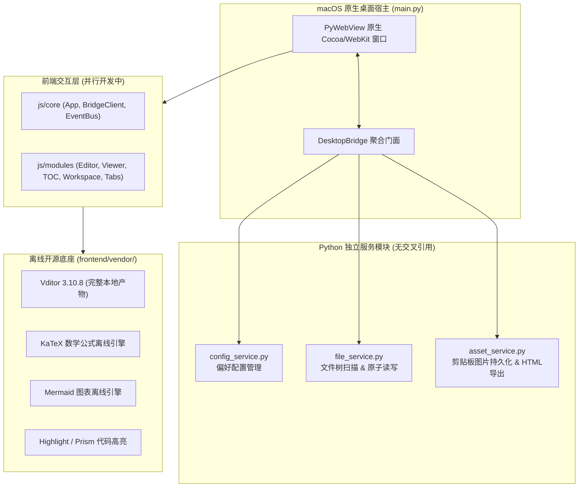

# Markdown Studio - 独立阅读与编辑器项目总结

## 1. 项目基本信息
- **项目名称**：Markdown Studio (独立 Markdown 阅读与编辑器)
- **项目位置**：`/Users/chenyidongting/Documents/5-Python/进行中/20-MarkdownReader-独立阅读编辑器-开发中`
- **定位**：面向 macOS 的纯原生独立桌面端 Markdown 阅读与编辑应用。彻底剥离 Chrome 浏览器扩展架构与包袱，以 GitHub 成熟开源组件 `Vditor` 为核心底座，结合 Python `pywebview` 原生宿主，实现 100% 离线、高精度排版、极低自研代码量的桌面级软件。

---

## 2. 架构设计与模块解耦



---

## 3. 目录结构与模块说明

```text
20-MarkdownReader-独立阅读编辑器-开发中/
├── backend/                        # 完全解耦的 Python 后端服务
│   ├── __init__.py
│   ├── config_service.py           # 用户偏好设置（~/.markdown_studio_prefs.json）
│   ├── file_service.py             # 文件与目录树读写、原子写入、编码容错、mtime 检测
│   ├── asset_service.py            # 剪贴板 Base64 图片解码保存至 ./assets、自包含 HTML 导出
│   └── bridge.py                   # PyWebView 门面 Facade（统一暴露 API 与原生对话框）
├── frontend/                       # 前端渲染层
│   ├── vendor/                     # 100% 完全离线第三方库
│   │   └── vditor/dist/            # Vditor 3.10.8 完整分发包（含 Katex, Mermaid, Lute, CSS 等）
│   ├── styles/                     # CSS 样式库（由前端模块负责）
│   └── js/                         # 前端业务逻辑（由前端模块负责）
│       ├── core/
│       └── modules/
├── sample/                         # 示例工作区
│   ├── welcome.md                  # 全功能 Markdown 演示文档
│   └── assets/                     # 示例图片与附件资源
│       └── welcome_cover.svg
├── main.py                         # 桌面端主程序入口（支持 --headless-check 自检）
├── run.command                     # macOS 双击一键启动脚本
├── requirements.txt                # Python 依赖清单
├── test_e2e.py                     # 全栈真实 WebKit 窗口端到端自动化验收套件
├── README.md                       # 使用与快速上手说明
├── PROJECT_SUMMARY.md              # 项目总结文档
└── HANDOVER.md                     # 详尽架构、接口契约与开发交接文档
```

---

## 4. 后端接口规范契约 (Bridge API)

所有接口统一返回标准 JSON 结构：`{"ok": True, "data": ...}` 或 `{"ok": False, "error": "..."}`。

| 接口名称 | 参数 | 返回数据结构 | 功能说明 |
| :--- | :--- | :--- | :--- |
| `get_initial_state()` | 无 | `{"preferences", "welcome_path", "workspace_dir", "project_root"}` | 获取初始化偏好配置及默认打开文档 |
| `read_file(path)` | `path: str` | `{"path", "name", "content", "mtime", "size"}` | 安全读取本地文件（UTF-8/GBK 容错） |
| `write_file(path, content)` | `path: str, content: str` | `{"path", "mtime", "size"}` | 原子写入磁盘，杜绝文件损坏 |
| `list_dir(...)` | `dir_path, show_hidden, sort_by, sort_asc` | `{"root", "tree": [...]}` | 递归扫描目录树（限深4层，目录在前排序） |
| `create_item(...)` | `parent_dir, name, is_dir` | `{"path": str}` | 新建文件（自动补 `.md`）或目录 |
| `rename_item(...)` | `old_path, new_name` | `{"path": str}` | 重命名文件或目录 |
| `delete_item(path)` | `path: str` | `{"path": str}` | 删除文件或空目录 |
| `check_files_mtime(paths)`| `paths: list` | `{path: mtime}` | 批量检查修改时间，供前端实现自动刷新 |
| `save_clipboard_image(...)`| `current_md_path, filename, base64_data` | `{"rel_path", "abs_path", "file_url"}` | 剪贴板图片存入 `./assets` 并生成相对路径 |
| `load_preferences()` | 无 | 用户配置字典 | 读取偏好设置 |
| `save_preferences(prefs)` | `prefs: dict` | 用户配置字典 | 持久化保存偏好设置 |
| `select_file_dialog()` | 无 | `{"path": str}` | 调起 macOS 原生文件选择器 |
| `select_folder_dialog()` | 无 | `{"path": str}` | 调起 macOS 原生目录选择器 |
| `export_html_dialog(...)`| `default_name, html_content` | `{"path": str}` | 调起原生保存器导出独立 HTML |

---

## 5. 验证与测试结果

### 5.1 后端接口自检 (Headless Backend Checks)
执行命令：
```bash
python3 main.py --headless-check
```
- **检查结果**：12 项核心接口自检 100% 通过（涵盖配置读写、原子写入、编码容错、目录树排序限深、新建/重命名/删除、剪贴板图像解码、独立 HTML 导出及桥接初始状态）。

### 5.2 全栈端到端集成测试 (Real E2E Integration Tests)
执行命令：
```bash
python3 test_e2e.py
```
- **检查结果**：14/14 项测试全部通过（100.0% PASS）：
  1. `[PASS]` 前端核心全局模块加载（AppStore, EditorEngine, BridgeClient 就绪）
  2. `[PASS]` 欢迎文档自动加载（welcome.md 4074 字符成功同步）
  3. `[PASS]` 工作区目录树实时渲染（sample 目录下文件/文件夹正常呈现在左侧文件树）
  4. `[PASS]` 编辑器内容双向同步
  5. `[PASS]` 多级目录大纲树生成（16 个标题节点层级构建，支持平滑滚动定位与 ScrollSpy）
  6. `[PASS]` 底部状态栏字数/行数/阅读耗时指标实时统计
  7. `[PASS]` 纯阅读模式（Reader Mode）切换与高保真居中排版
  8. `[PASS]` GitHub / Obsidian 风格 Callout 容器增强转换（NOTE, TIP, WARNING, DANGER 全部正确渲染）
  9. `[PASS]` 本地图片相对路径自动解析为 `file://` 协议，无破损加载
  10. `[PASS]` 双栏分屏（SV）模式无缝切换与同步
  11. `[PASS]` 所见即所得（WYSIWYG）模式无缝切换
  12. `[PASS]` 即时渲染（IR）模式平滑回退与重新挂载
  13. `[PASS]` 外观偏好设置动态响应与 CSS 变量实时更新
  14. `[PASS]` 全程零未捕获 JavaScript 运行时异常（Zero Uncaught Errors）

