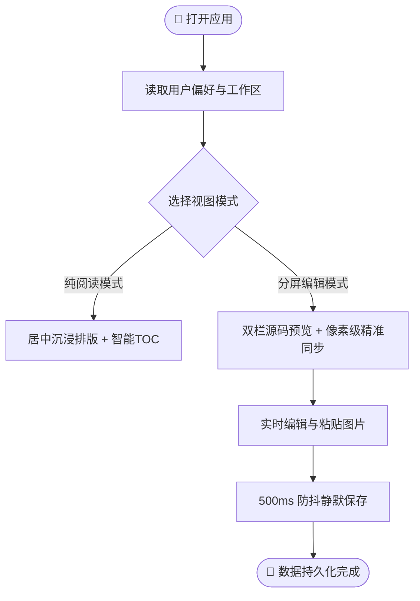
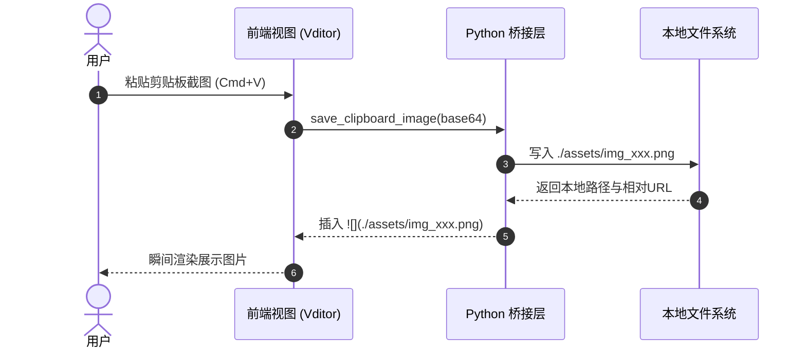

# 欢迎使用 Markdown Studio

> 一款基于原生 macOS 窗口与成熟开源底座构建的高性能、现代化独立 Markdown 阅读与编辑器。

---

## 📖 核心功能概览

Markdown Studio 致力于提供媲美 Typora 与 Obsidian 的沉浸式阅读与高效编辑体验：

- [x] **完全离线运行**：所有解析引擎、字体、公式及图表库均内嵌于本地。
- [x] **高精度排版**：全面支持 GFM 规范、任务列表、数学公式、复杂图表与代码高亮。
- [x] **智能目录大纲 (TOC)**：随正文滚动自动高亮追踪当前章节，点击丝滑跳转。
- [x] **剪贴板截图本地化**：直接从剪贴板粘贴图片，自动存入本地 `./assets` 目录。
- [ ] **更多高级插件扩展**：持续集成学术引用、脑图导图与自定义样式。

---

## 💡 提示块 (Callouts / Admonitions)

> [!NOTE]
> 这是一个 **NOTE** 提示块，常用于展示辅助背景信息或补充说明。

> [!TIP]
> 这是一个 **TIP** 技巧提示块。使用快捷键 `Cmd + S` 即可快速保存文档，系统同时支持 500ms 静默自动保存。

> [!WARNING]
> 这是一个 **WARNING** 警告块，请注意保存重要文档并定期备份工作区。

> [!DANGER]
> 这是一个 **DANGER** 危险警示块，删除文件操作将从磁盘移除目标项，请谨慎操作！

---

## 🧮 数学公式支持 (KaTeX)

Markdown Studio 原生内嵌离线 KaTeX 高性能渲染引擎，完美支持复杂行内与块级公式：

### 行内公式 (Inline Math)
质能方程由爱因斯坦提出：$E = mc^2$。高斯求和公式为 $\sum_{i=1}^{n} i = \frac{n(n+1)}{2}$，欧拉公式则将五个基本常数联系在一起：$e^{i\pi} + 1 = 0$。

### 独立多行公式 (Block Math)
麦克斯韦方程组与傅里叶变换：

$$
\hat{f}(\xi) = \int_{-\infty}^{\infty} f(x) e^{-2\pi i x \xi} \, dx
$$

矩阵与行列式示例：

$$
\mathbf{A} = \begin{pmatrix}
a_{11} & a_{12} & \cdots & a_{1n} \\
a_{21} & a_{22} & \cdots & a_{2n} \\
\vdots & \vdots & \ddots & \vdots \\
a_{m1} & a_{m2} & \cdots & a_{mn}
\end{pmatrix}, \quad
\det(\mathbf{A}) = \sum_{\sigma \in S_n} \operatorname{sgn}(\sigma) \prod_{i=1}^n a_{i, \sigma(i)}
$$

---

## 📊 图表与可视化 (Mermaid)

### 1. 业务交互流程图 (Flowchart)



### 2. 系统时序交互图 (Sequence Diagram)



---

## 💻 丰富代码高亮与行号

支持主流多语言语法精准着色、行号展示以及一键复制代码：

### Python 代码示例
```python
import os
import webview

class AppBridge:
    """Python 与 Webview 交互的核心桥接门面"""
    def __init__(self, workspace: str):
        self.workspace = os.path.abspath(workspace)

    def read_file(self, filename: str) -> dict:
        target = os.path.join(self.workspace, filename)
        with open(target, "r", encoding="utf-8") as f:
            return {"ok": True, "content": f.read()}

if __name__ == "__main__":
    bridge = AppBridge("./sample")
    webview.create_window("Markdown Studio", url="./frontend/index.html", js_api=bridge)
    webview.start()
```

### TypeScript / JavaScript 示例
```typescript
interface DocumentState {
  path: string;
  isDirty: boolean;
  mtime: number;
}

export function debounce<T extends (...args: any[]) => void>(fn: T, delay = 500): T {
  let timer: NodeJS.Timeout | null = null;
  return ((...args: any[]) => {
    if (timer) clearTimeout(timer);
    timer = setTimeout(() => fn(...args), delay);
  }) as T;
}
```

---

## 📑 表格与扩展语法排版

| 编号 | 模块名称 | 职责定位 | 状态标记 | 优先级 |
| :---: | :--- | :--- | :---: | :---: |
| 01 | **Core Engine** | Vditor 离线底座与语法渲染 | `已就绪` | 🔴 P0 |
| 02 | **Desktop Bridge** | PyWebView 本地文件读写与原子保存 | `已就绪` | 🔴 P0 |
| 03 | **TOC Navigator** | 目录树提取与滚动位置高亮追踪 | `开发中` | 🟡 P1 |
| 04 | **Asset Manager** | 剪贴板图像解码与相对路径维护 | `已就绪` | 🟡 P1 |
| 05 | **Theme Switcher**| 亮色/暗黑模式及主题样式切换 | `开发中` | 🟢 P2 |

### 扩展语法演示
- 文本标记高亮：==Markdown Studio 让阅读更舒适==
- 上下标示例：水分子化学式为 H~2~O，爱因斯坦质量能量关系 $E=mc^2$ 中的 $c^2$
- 脚注声明：本软件完全采用本地优先架构[^1]，不向任何外部公网服务器上传数据。

---

## 🖼️ 图片引用与尺寸控制

支持标准 Markdown 相对路径引用及 HTML 宽度微调：

{width=100%}

---

## 📝 任务清单协同

- [x] 完成 Python 模块化后端架构设计与解耦
- [x] 完成 Vditor @3.10.8 完整依赖离线化部署
- [x] 验证 KaTeX 数学公式渲染性能
- [x] 验证 Mermaid 图表生成逻辑
- [ ] 联调多标签页 (Tabs) 切换与工作区文件树
- [ ] 发布首个 macOS 独立运行免安装应用版本

---

[^1]: 本地优先 (Local-First) 设计原则确保了用户数据的绝对安全与隐私，无网络环境下功能依然百分之百可用。
